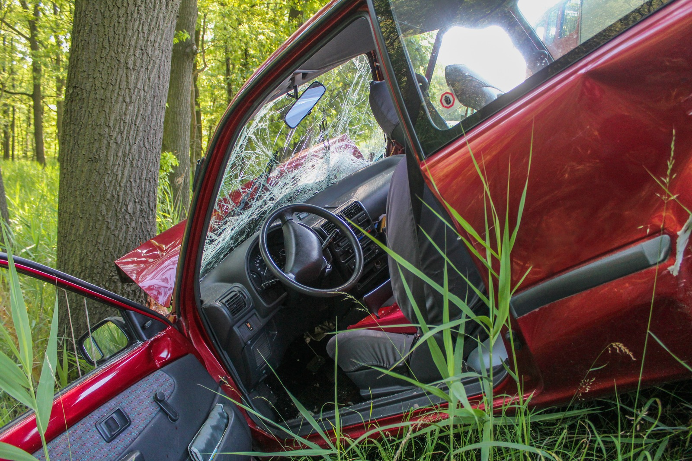
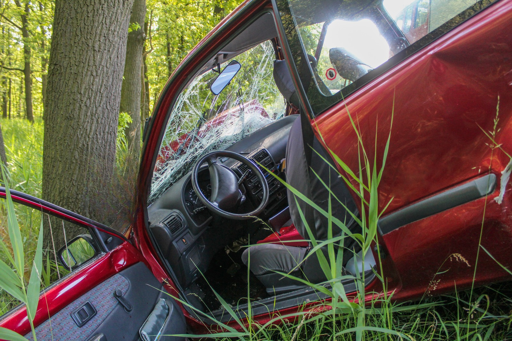
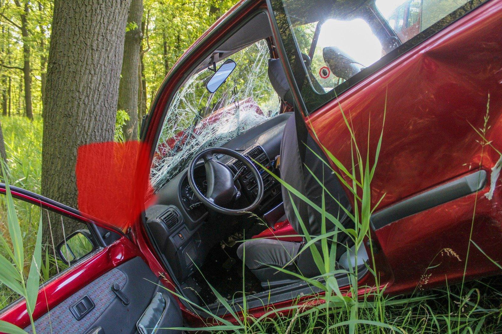

# claim-photo-toolkit

Command-line and Python tools for checking whether **part of a car-damage photo was AI-edited**
(inpainted to add, remove or exaggerate damage). It runs the
[Car Damage Photo Integrity v9](https://huggingface.co/obuladinnesai/car-damage-photo-integrity-v9)
model locally and returns a suspicion score, a pass/flag decision and a **tamper heatmap**.

- 🤗 Model: [obuladinnesai/car-damage-photo-integrity-v9](https://huggingface.co/obuladinnesai/car-damage-photo-integrity-v9), pinned to revision [`4b7b6ea`](https://huggingface.co/obuladinnesai/car-damage-photo-integrity-v9/tree/4b7b6ea59cc125119794b2f5a49efb966ec3e5ff)
- ▶️ Browser demo (no install): [claim-photo-integrity-demo](https://huggingface.co/spaces/obuladinnesai/claim-photo-integrity-demo)

> Research and screening tool. A flag is not proof of editing or fraud, and a pass does not
> certify a photo as real. Keep a human in the loop.

## Quick-start

Needs Python 3.10+ (tested on 3.10 and 3.12) and about 4 GB of free RAM. No Hugging Face token needed.

```bash
git clone https://github.com/saiobuladinne/claim-photo-toolkit.git
cd claim-photo-toolkit
python -m venv .venv && source .venv/bin/activate   # Windows: .venv\Scripts\Activate.ps1
pip install -r requirements.txt
python inference.py --image examples/car.jpg --overlay out/overlay.png
```

The first run downloads the 118 MB checkpoint into your Hugging Face cache. Expected output
(one JSON line per image):

```json
{"image": "car.jpg", "score": -5.1932, "threshold": 4.1931, "flagged": false, "condition": "upload", "max_heat": 0.0086, "revision": "4b7b6ea59c"}
```

The example is an unedited CC0 photo ([credits](examples/README.md)), so it is correctly not flagged
and its heatmap is close to blank. Now try a deliberately AI-edited copy, with the crumpled front panel
removed by LaMa inpainting:

```bash
python inference.py --image examples/car_inpainted.png --overlay out/edited_overlay.png
```

```json
{"image": "car_inpainted.png", "score": 8.3073, "threshold": 4.1931, "flagged": true, "condition": "upload", "max_heat": 0.9998, "revision": "4b7b6ea59c"}
```

The overlay marks the removed panel in red. It overlaps the true edit mask with IoU 0.90
([`examples/car_inpainted_mask.png`](examples/car_inpainted_mask.png)).

| Unedited `car.jpg` | AI-edited `car_inpainted.png` | Heatmap overlay |
|---|---|---|
|  |  |  |

| Field | Meaning |
|---|---|
| `score` | Mean of the 256 highest edit-map logits. Higher = more suspicious. Can be negative; not a probability |
| `threshold` | Operating point for the chosen `--condition` (2% false-positive rate on the author's 600-photo benchmark) |
| `flagged` | `score >= threshold` |
| `max_heat` | Highest heatmap value, 0–1 |

`--heatmap PATH` saves the grayscale map; `--overlay PATH` saves it blended in red over the photo.

## Preprocessing conditions

| `--condition` | What happens before scoring | When to use |
|---|---|---|
| `upload` (default) | Resize to max side 1600 px, re-save as JPEG q85 | Phone photos and most uploads; bounded memory |
| `jpeg_q90` | Re-save as JPEG q90 at full resolution | Matches the model card's headline benchmark (85.3% TPR); small images only |
| `native` | Score the file as-is | Not recommended; benchmark thresholds are not comparable |

## Speed and memory (CPU)

Measured on an Apple M5 Pro laptop with `--device cpu`, whole process including model load. Without `--device`, the script uses CUDA or Apple MPS when available. Scores are the same either way.

| Input | Condition | Time | Peak RAM |
|---|---|---:|---:|
| 1600×1067 (`examples/car.jpg`) | `upload` | 14 s | 4.5 GB |
| 1200×900 | `upload` | 9 s | 3.6 GB |
| 4000×3000 (12 MP) | `upload` | 11 s | 5.5 GB |
| 4000×3000 (12 MP) | `jpeg_q90` | 106 s | 13.7 GB |

`jpeg_q90` and `native` do not resize, so memory grows with the image. The script warns above 4 MP.

## Use from Python

```python
import importlib.util
from huggingface_hub import hf_hub_download

spec = importlib.util.spec_from_file_location("v9_inference", "v9/inference.py")
v9 = importlib.util.module_from_spec(spec); spec.loader.exec_module(v9)

rev = "4b7b6ea59cc125119794b2f5a49efb966ec3e5ff"
repo = "obuladinnesai/car-damage-photo-integrity-v9"
net, cfg, device = v9.load_model(hf_hub_download(repo, "model.safetensors", revision=rev),
                                 hf_hub_download(repo, "config.json", revision=rev), "cpu")
result = v9.score_image(net, cfg, device, "examples/car.jpg", condition="upload")
print(result["score"], result["flagged"], result["heatmap"].shape)
```

## Known failure cases

From the [model card](https://huggingface.co/obuladinnesai/car-damage-photo-integrity-v9) (author-reported, `upload` condition):

- **Small edits** (0.5–3% of the image) are caught 61% of the time.
- **Fully AI-generated scenes** are caught 41% of the time. v9 targets *localized* edits.
- Thresholds were set on CarDD photos. Other cameras, compression levels, editors and newer generators can shift scores. Recalibrate on your own data.
- Large images under `jpeg_q90`/`native` can run out of memory (see above).
- **Compression history matters.** Re-saving `car_inpainted.png` as JPEG q92 makes the default `upload` condition miss it (score -5.73), while `jpeg_q90` still catches it. See [examples/README.md](examples/README.md#known-failure-re-saving-the-edit-as-jpeg) for the quality sweep and how to reproduce it.
- Simple copy-and-paste edits within the same photo may not be detected. A 1.4%-area copy-move patch on `examples/car.jpg` scored -5.74 (not flagged). The model is trained mainly on diffusion and LaMa inpainting.

## What is in this repository

| Path | Purpose |
|---|---|
| `inference.py` | CLI: downloads the pinned weights, scores images, writes heatmaps/overlays |
| `v9/` | Unmodified `inference.py` and `model_v9.py` from the pinned Hub revision. `python scripts/verify_vendored.py` checks them |
| `examples/` | A CC0 sample photo, a labelled AI-edited copy with its ground-truth mask, and the expected outputs |
| `scripts/make_inpainted_example.py` | Recreates the edited example with LaMa |

Training and evaluation code, reports and licensing notes for the training data are on the
[model page](https://huggingface.co/obuladinnesai/car-damage-photo-integrity-v9).

## Feedback

Please report results, especially failures, in the model's
[community discussion](https://huggingface.co/obuladinnesai/car-damage-photo-integrity-v9/discussions/1)
or as a GitHub issue. Include the revision, `--condition`, your OS/device and the JSON output.
Only share images you are authorized to share.

## License

Code: Apache-2.0 (see [LICENSE](LICENSE)). Read the model card's
[licensing section](https://huggingface.co/obuladinnesai/car-damage-photo-integrity-v9#licensing-and-data-permissions)
for training-data terms.
